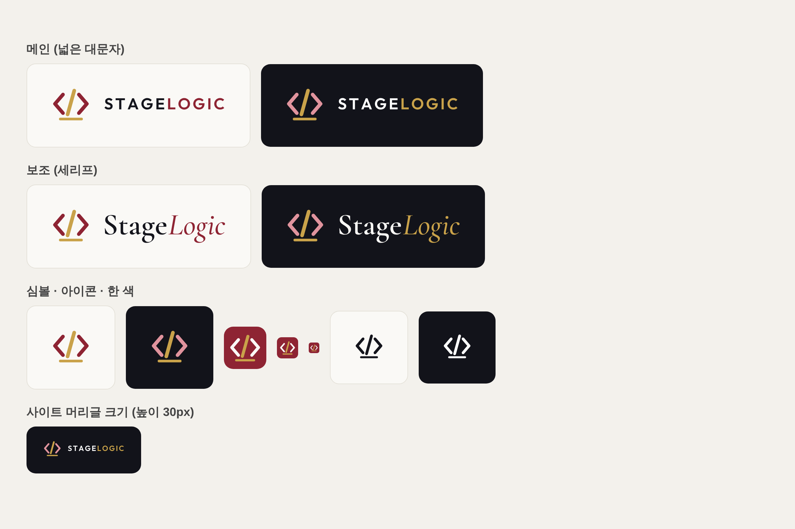

# 스테이지로직 로고 · 브랜드 가이드

확정: 2026-10-20 · 시안 **K2** (코드 기호 `</>` × 무대)



## 뜻

- 양옆 꺾쇠 `< >` + 가운데 빗금 `/` = 코드 기호 `</>` → **로직(기획 · 코드)**
- 아래 금색 선 = **무대 바닥** → 그 위에 코드가 선다
- 버건디(공연장 커튼 색) + 금색(무대 조명 · 바닥)

## 파일 (`assets/brand/`)

| 파일 | 쓰는 곳 |
|---|---|
| `stagelogic-logo.svg` / `.png` | **메인** · 밝은 배경 (넓은 대문자 STAGELOGIC) |
| `stagelogic-logo-dark.svg` / `.png` | **메인** · 어두운 배경 — 사이트 머리글 · 꼬리말 |
| `stagelogic-logo-serif.svg` / `.png` | **보조** · 밝은 배경 (세리프 StageLogic) — 공연 소개 · 제안서 · 인쇄물 |
| `stagelogic-logo-serif-dark.svg` / `.png` | **보조** · 어두운 배경 |
| `stagelogic-mark.svg` · `-dark.svg` | 심볼만 (밝은 · 어두운 배경) |
| `stagelogic-mark-black.svg` · `-white.svg` | 한 색 (인쇄 · 도장 · 각인) |
| `stagelogic-icon.svg` · `-icon-512.png` | 아이콘 (버건디 둥근 네모) — 파비콘 · 프로필 사진 |
| `assets/favicon.svg` | 사이트 탭 아이콘 (= `stagelogic-icon.svg`) |
| `assets/app/work-*.png` | `/work/` 앱 설치 아이콘 |

- SVG는 글자를 도형으로 바꿔 둬서 글꼴이 없는 컴퓨터에서도 똑같이 보임
- PNG는 높이 256px · 투명 배경 (문서 · 슬라이드용)

## 색

| 이름 | 값 | 쓰임 |
|---|---|---|
| 버건디 | `#8e2433` | 꺾쇠 · 밝은 배경의 LOGIC · 아이콘 바탕 |
| 버건디(어두운 배경용) | `#e0939d` | 어두운 배경의 꺾쇠 |
| 금색 | `#c9a24a` | 빗금 · 무대 바닥 · 어두운 배경의 LOGIC (사이트 `--gold`와 같음) |
| 먹색 | `#14151c` | 밝은 배경의 STAGE |
| 크림 | `#faf9f6` | 아이콘 위 꺾쇠 · 밝은 바탕 |

## 글씨

- 메인: **Outfit SemiBold(600)**, 대문자, 자간 0.13em — `STAGE` + `LOGIC`(색 다르게)
- 보조: **Cormorant Garamond** — `Stage` SemiBold(600) + `Logic` Italic Medium(500)
- 한글 표기: Pretendard Bold, `스테이지` + `로직`(색 다르게)

## 쓸 때 지킬 것

- 심볼과 글자 사이 간격 · 비율을 바꾸지 않기 (파일 그대로 크기만 조절)
- 아주 작게(16~32px) 쓸 때는 글자 없이 **아이콘**만
- 사진 위에는 어두운 배경용(`-dark`) 또는 한 색(흰색) 버전
- 색을 임의로 바꾸지 않기 — 한 색이 필요하면 `-black` / `-white`

## 다시 만들기 (모양 · 색을 고칠 때)

```bash
pip install fonttools
python3 design/logo/tools/build.py   # SVG 만들기 (글꼴은 처음 한 번 자동으로 받음)
node design/logo/tools/png.mjs       # PNG · 앱 아이콘 만들기 (playwright 필요)
```

모양(`mark()`), 색(맨 위 상수), 글자 크기 · 자간은 `build.py` 안에 있음. `png.mjs`의 `mark()`도 같이 고칠 것.

## 시안 기록 (`drafts/`)

| 순서 | 파일 | 내용 · 결과 |
|---|---|---|
| 0 | `round-stage/` | 첫 시안 A~D, 원형 무대 E1~E3 — "별로, 글씨체도 별로"로 다시 시작 |
| 1 | `1-six-directions` | 6방향(무대 선 · 아치 · 커튼 · 스포트라이트 · 괄호 · 한글) — A · D · F 탈락, **"코드와 무대가 함께 있어야"** |
| 2 | `2-code-stage` | 코드 × 무대 G1~G6 — 꺾쇠를 조명이라 한 설명은 억지(탈락), **G2 모양은 마음에 듦** |
| 3 | `3-arch-curtain-code` | 아치 · 커튼 · 코드 H1~H6 — H4 · H5 좋음, 버건디 · 글씨체 좋음 |
| 4 | `4-h4-h5` | H4 · H5 다듬기 |
| 5 | `5-g2-burgundy` | G2 모양 × 버건디 K1~K4 — **K2 확정**, 글씨는 넓은 대문자(메인) + 세리프(보조) |

각 `.html`은 브라우저로 열면 시안 표가 다시 보임 (구글 폰트 사용).
